# What you'll build

A personal website that works like a phone. On a laptop, visitors see a 3D phone resting in a calm studio. They can turn it over to look at the back, then use its screen exactly like a real phone: open apps, swipe between home pages, pull down Control Center. On a real phone, the website *becomes* the phone and fills the screen.

Every section of your portfolio is an app on the home screen: your courses or products, your story, your skills, your projects, your blog, your services and a contact form.

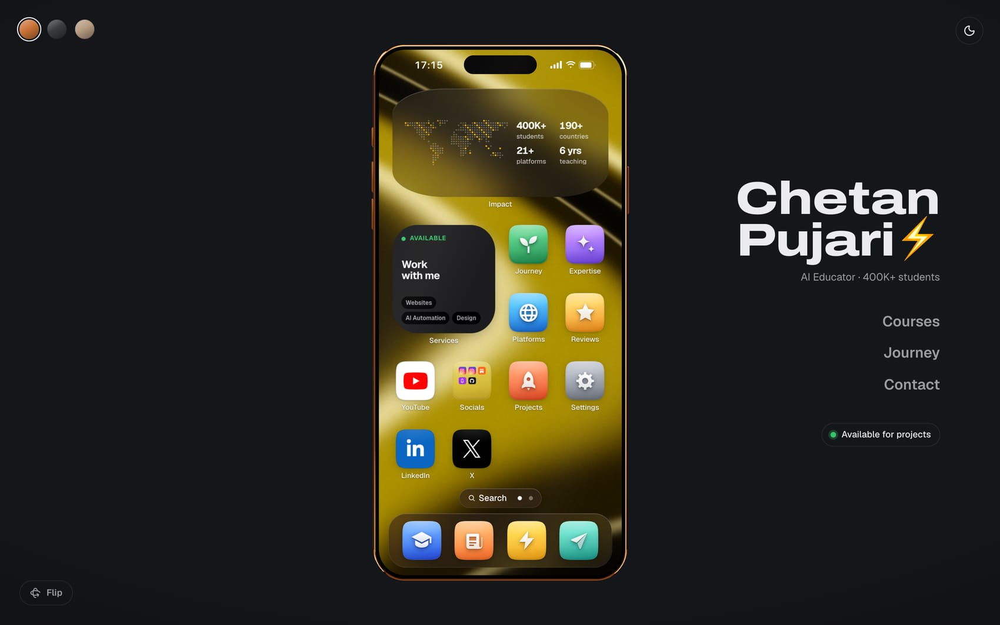

::: figures
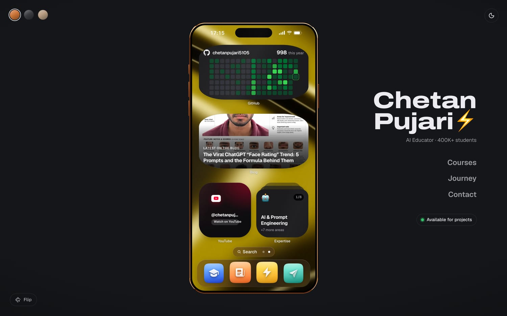
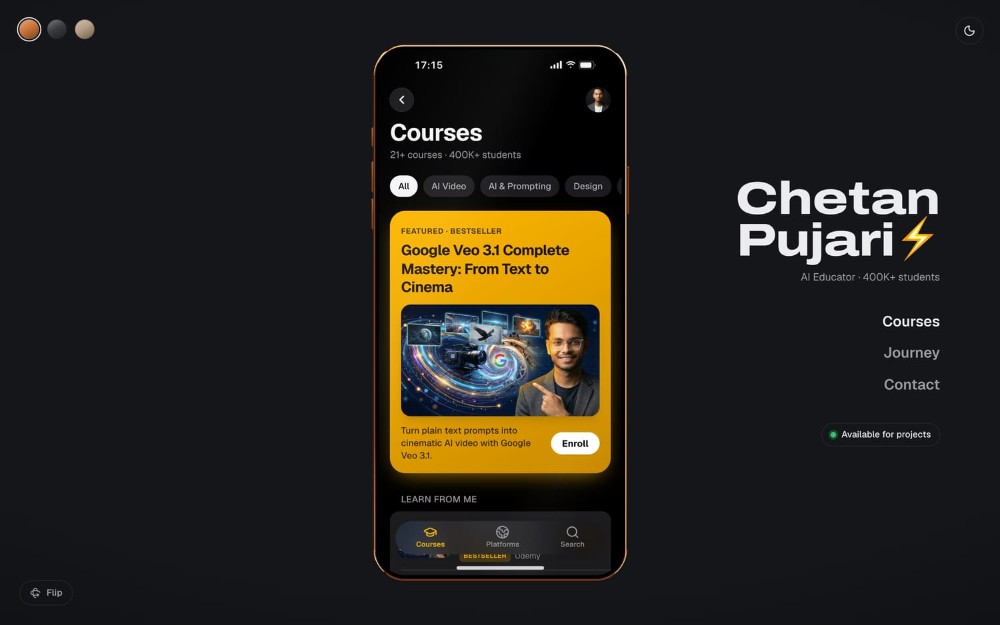
:::

::: figures
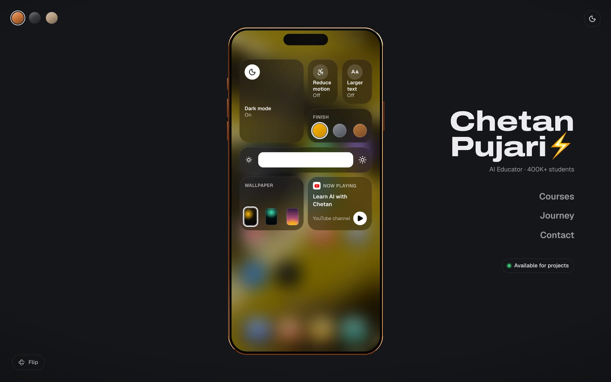

:::

::: figures-3
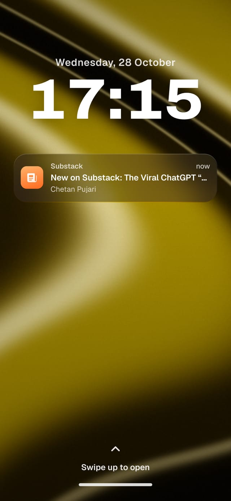
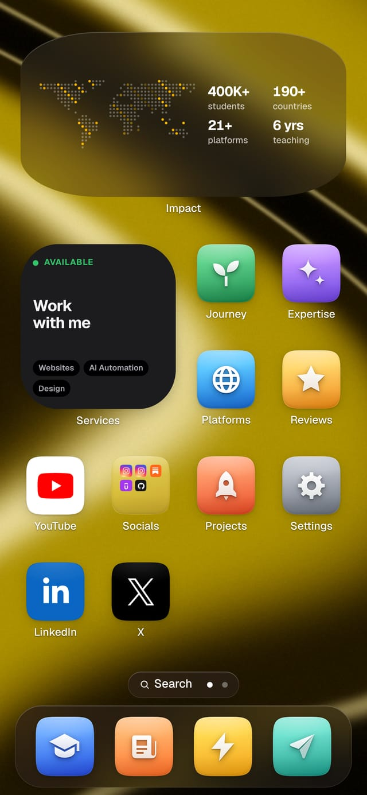
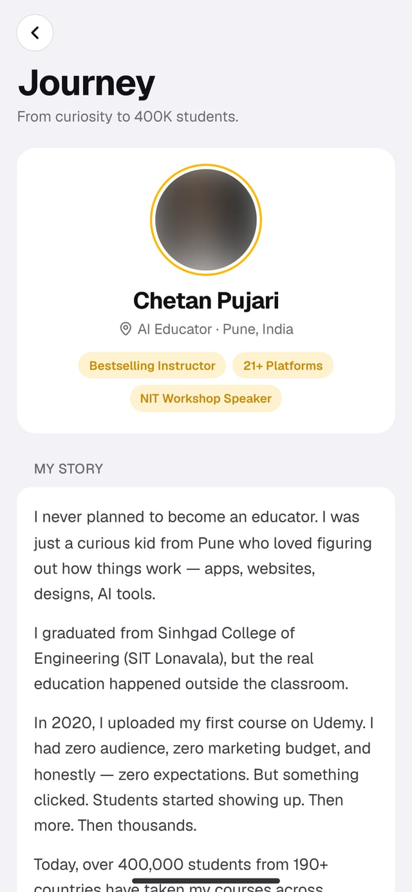
:::

## Features

- **3D phone you can turn over.** Drag beside it (never on the screen) and it settles on its front or back. Clicks never move it.
- **A real phone feel.** Lock screen with swipe up, apps that launch from their icon and close with a swipe on the home bar, an app switcher, home pages you swipe between, pull-down search.
- **A home screen visitors can edit.** Long-press an icon to move apps, make folders, remove apps, edit the dock and add apps back from the App Library.
- **Fits every phone.** The home screen works out its columns, icon size and pages from the screen it's on, from a small 320×568 phone to a phone on its side.
- **Live content.** A GitHub contribution heatmap, your latest blog posts from RSS, your latest YouTube video, and a contact form that emails you.
- **Installable.** "Add to Home Screen" on a phone opens it full screen like an app.
- **Your look.** Light and dark themes, three phone finishes, three wallpapers. Larger text and reduce-motion settings.
- **Fast and accessible.** Apps start opening in the same frame as the tap, and repeat visits load almost at once, even offline. Our build scored Lighthouse 100 on desktop and 93 on mobile for performance, and 100 for accessibility, best practices and SEO.

## New in v5

Version 1.1 of this guide adds v5 of the site, and the template includes all of it. On Path B it's Prompt 7.

- **Fits every phone.** Nothing is cut off on any of 17 tested screen sizes, with the browser toolbars and the keyboard showing, and in landscape. Icons that don't fit move to the next page, like on a real phone.
- **Folders.** Drop one app on another and hold: they make a folder you can name. The Socials folder is a normal folder now.
- **Remove apps, and the App Library.** Press "–" to take an app off the home screen. It waits in the App Library (the "+" in edit mode, or Settings → Home Screen) until you add it back. Settings can't be removed, and a reset brings back the original layout.
- **Speed.** Every app's code is on the device before the first tap, so a window starts growing in the same frame. Launches settle in about 0.4 s instead of 0.85 s on a slowed-down phone, and a service worker makes repeat visits load in about 70 ms.

::: figures-3
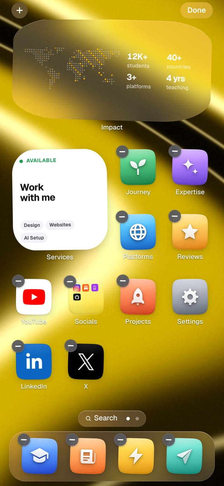
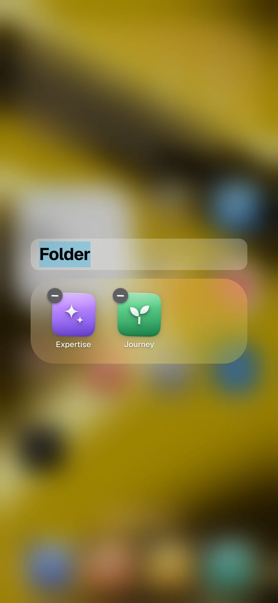
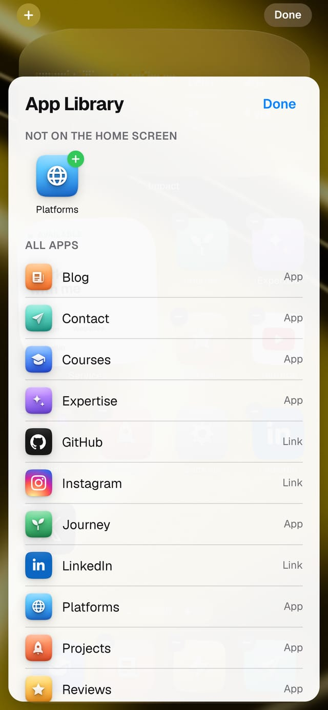
:::

::: figures-3
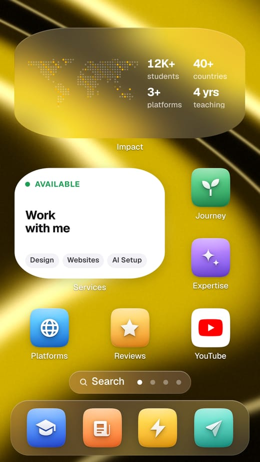
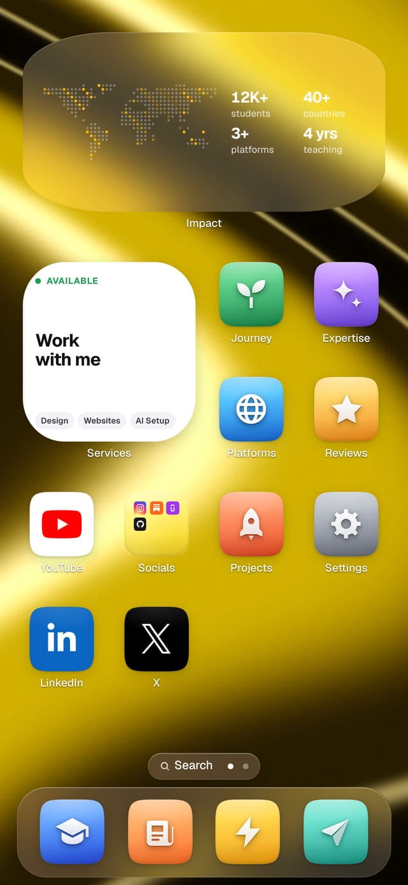
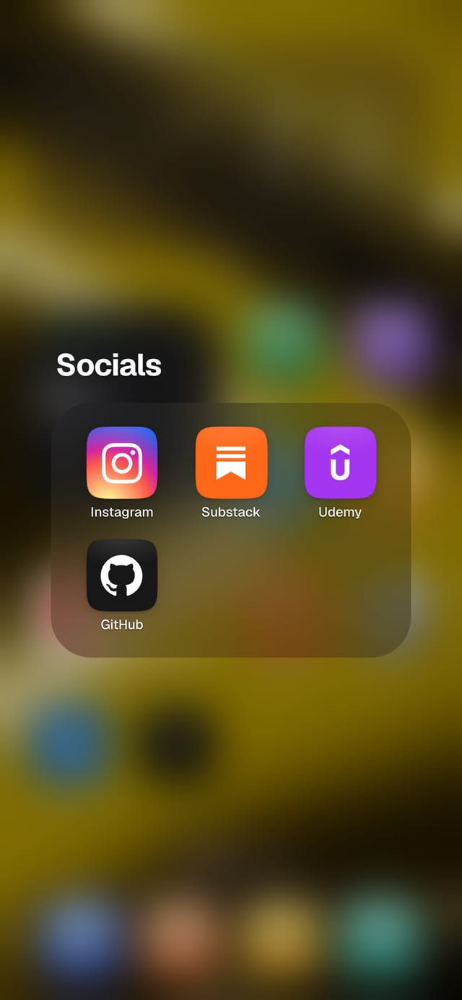
:::

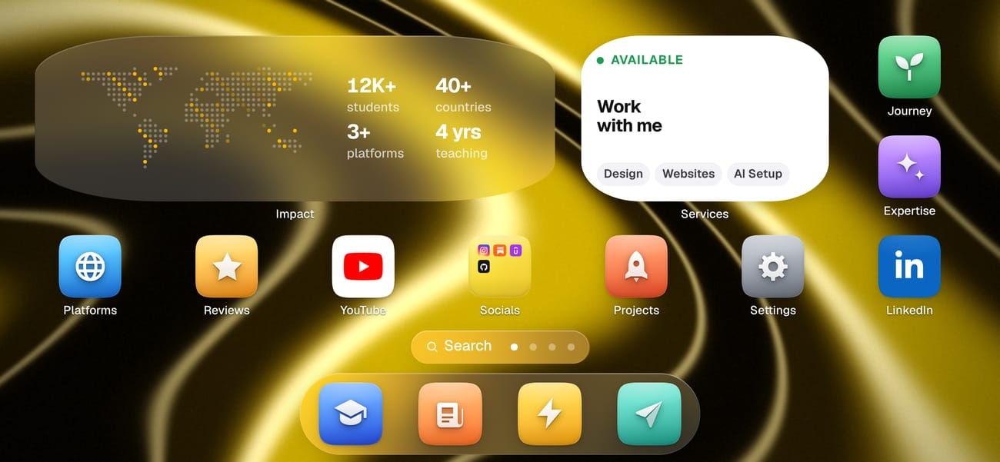


# Two ways to do it

You can get the same site in two ways. Both use Claude Code, an AI assistant that reads and writes code in a folder on your computer. You describe what you want in plain English; it does the typing, runs the checks and shows you the result.

::: decision
**Path A: the Fast Track (recommended).** About 1 to 2 hours.
Start from the finished template, fill in a worksheet about yourself, and run one prompt that puts your details, photos and colours into the site. Best for most people, including non-developers.

**Path B: From Scratch.** About 1 to 2 days of Claude Code time (mostly waiting while it works).
Run the same series of seven prompts that built the original site. You'll watch it being built phase by phase, and you can change the design along the way. Best if you want to learn how it works, or want something quite different.
:::

**Not sure?** Pick Path A. You can still change anything afterwards, and the "Fix list" prompt (Chapter 6) works on both.

| | Path A: Fast Track | Path B: From Scratch |
|---|---|---|
| Time | 1–2 hours | 1–2 days of Claude Code time |
| You start with | The template (working site with sample content) | An empty folder |
| Prompts to run | 1, plus fix lists | 7 in order, plus fix lists |
| Usage of your Claude plan | Low | High (expect to hit usage limits and type `continue`) |
| Result | The same site, with your content | Your own build, which you can steer as it grows |

Whichever path you take, chapters 3 to 5 come first: get the tools, set up the toolbox, and gather your content.

# What you need before you start

Prices change, so this guide doesn't quote them. Check each provider's current pricing page before you sign up.

| You need | Why | Cost | Link |
|---|---|---|---|
| A Mac, Windows or Linux computer | Claude Code runs in a terminal on your computer | – | – |
| A Claude plan that includes Claude Code (Pro, Max, Team or Enterprise) | Claude Code does the building | Paid; check current pricing | [Pricing](https://claude.com/pricing) |
| Claude Code | The assistant itself | Included with the plan | [Quickstart](https://code.claude.com/docs/en/quickstart) |
| Node.js, LTS version (24 or newer) | Runs the website on your computer | Free | [Download](https://nodejs.org/en/download) |
| Git | Saves versions of your project and uploads it | Free | [Download](https://git-scm.com/downloads) |
| A GitHub account | Stores your project online | Free plan available | [Sign up](https://github.com/signup) |
| A Vercel account | Puts your site on the internet | Free Hobby plan for personal projects; check current pricing | [Sign up](https://vercel.com/signup) |
| Optional: a Resend account | Lets the contact form email you | Free tier available; check current pricing | [Pricing](https://resend.com/pricing) |
| Optional: your own domain | `yourname.com` instead of a vercel.app address | Paid, from any registrar | – |
| Optional: a GitHub token | A more reliable GitHub heatmap | Free | [Docs](https://docs.github.com/en/authentication/keeping-your-account-and-data-secure/managing-your-personal-access-tokens) |

## Install Claude Code

::: step 1 | Open a terminal
On a Mac, open **Terminal** (press Cmd+Space, type "Terminal"). On Windows, open **PowerShell**. If you've never used a terminal, the official [terminal guide](https://code.claude.com/docs/en/terminal-guide) shows you how.
:::

::: step 2 | Install Claude Code
Copy the line for your computer from the official [quickstart](https://code.claude.com/docs/en/quickstart) and press Enter.

```terminal
# macOS, Linux, WSL
curl -fsSL https://claude.ai/install.sh | bash

# Windows PowerShell
irm https://claude.ai/install.ps1 | iex
```

Then open a **new** terminal window and check it worked:

```terminal
claude --version
```

✅ You see a version number followed by "(Claude Code)".
:::

::: step 3 | Install Node.js and Git
Download the LTS installer from [nodejs.org](https://nodejs.org/en/download) and Git from [git-scm.com](https://git-scm.com/downloads). Run both installers with the default options.

```terminal
node --version
git --version
```

✅ Node prints `v24` or higher, and Git prints a version.
:::

::: step 4 | Sign in
In the terminal, run `claude`. The first time, it opens your browser to sign in with your Claude account.

✅ You see the Claude Code prompt, with your folder shown above it.
:::

::: tip
**Permission modes.** Claude Code asks before it edits files or runs commands. For long builds, press **Shift+Tab** until the status bar shows `⏵⏵ accept edits on`, so it can edit files in your project folder without asking each time. Press Shift+Tab again to switch back.
:::

# Set up your toolbox

Claude Code can load extra **skills** (written know-how, like a design or animation playbook), **plugins** (bundles of skills and commands) and **MCP servers** (connections to tools, like live documentation or a browser). These are the ones used to build the original site.

| Name | What it does | Why we used it | Required? | Official install |
|---|---|---|---|---|
| Context7 (MCP) | Up-to-date docs for any library | Checked Next.js, Motion, React Three Fiber, drei, Zod and Playwright APIs before writing code | **Required** | `npx ctx7 setup --claude` ([upstash/context7](https://github.com/upstash/context7)) |
| Playwright | Drives a real browser from code | Screenshots, recordings and 140+ automated tests | **Required** (comes with the project) | `npx playwright install chromium`; MCP: `claude mcp add playwright npx @playwright/mcp@latest` ([microsoft/playwright-mcp](https://github.com/microsoft/playwright-mcp)) |
| Claude in Chrome | Lets Claude Code use your Chrome browser | Clicking through the site, checking layouts | Optional (Playwright works too) | Chrome extension + `claude --chrome` ([docs](https://code.claude.com/docs/en/chrome)) |
| emil-design-eng, animate, apple-design | Animation and interface-craft playbooks by Emil Kowalski | Springs, gestures, interruptible motion, the "feels like a phone" details | Recommended | `npx skills@latest add emilkowalski/skills` ([emilkowalski/skills](https://github.com/emilkowalski/skills)) |
| impeccable | Design direction and polish | Visual hierarchy, icon and home-screen polish | Recommended | `/plugin marketplace add pbakaus/impeccable`, then install it from `/plugin` ([pbakaus/impeccable](https://github.com/pbakaus/impeccable)) |
| web-design-guidelines, vercel-react-best-practices | UI review rules and React/Next.js performance rules from Vercel | Accessibility review, keeping the first load under 200 KB | Recommended | `npx skills add vercel-labs/agent-skills` ([vercel-labs/agent-skills](https://github.com/vercel-labs/agent-skills)) |
| REA (Reverse Engineer Anything) | Inspects how apps and websites behave | **Not used** in our build; we studied behaviour with Playwright recordings instead | Optional | `npx rea-agents setup` ([morluto/rea](https://github.com/morluto/rea)) |
| Agent Reach | Reads the wider web (web, GitHub, YouTube) | **Not used** in our build; public RSS feeds were enough | Optional | See its [install guide](https://github.com/Panniantong/Agent-Reach/blob/main/docs/install.md) |

::: note
**Version notes.** The `skills` installer needs Node.js 22.20 or newer, and the `ctx7` setup tool needs 22.13 or newer. Node 24 LTS covers both. If `npx ctx7 setup` waits for a login you don't want, add Context7 to just this project instead: `claude mcp add --transport http --scope project context7 https://mcp.context7.com/mcp`.
:::

## Let Claude Code set it up

Open your project folder in Claude Code (for Path A, the template folder; for Path B, an empty folder) and paste this prompt.

```prompt 01-toolbox.md
Set up my toolbox for building a website with Next.js, React Three Fiber and Playwright.

1. Take stock first. List every skill, plugin and MCP server I already have:
   ~/.claude/skills, ./.claude/skills, /plugin (installed), claude mcp list, and any CLAUDE.md.
   Show me a short table: Name | What it does | Useful here? (yes/no + why).

2. Install whatever is missing from this list, from these official sources only:
   - Context7 MCP (https://github.com/upstash/context7): run "npx ctx7 setup --claude" and
     choose MCP mode. If it waits for a login, use instead:
     claude mcp add --transport http --scope project context7 https://mcp.context7.com/mcp
     Then add this line to ./CLAUDE.md: "Always use Context7 when you need library/API docs,
     code generation, setup or configuration steps."
   - Emil Kowalski's skills: npx skills@latest add emilkowalski/skills
   - Vercel's agent skills: npx skills add vercel-labs/agent-skills
   - Playwright's browser: npx playwright install chromium
   Ask me before any global install or any change to my agent settings.

3. Do NOT install REA or Agent Reach unless I ask for them later.

4. Tell me which tools need a Claude Code restart to load, and what to type after restarting.
```

✅ You're done when Claude Code shows a table of your tools, says which ones it installed, and `claude mcp list` shows `context7 ... Connected` after a restart.

::: warning
**Safety notes**

- **Install only from official sources:** the GitHub repos and docs linked in the table. Never install a package because a search result or a random page suggests it. Agent Reach's own guide warns that the `agent-reach` package on PyPI is **not** this project.
- **Agent Reach stays read-only** if you ever use it: default channels only (web, GitHub, YouTube), no login-based channels, and never copy browser sessions or cookies without your clear consent.
- **REA is for studying how interactions *behave*** (how long an animation takes, whether it springs back). Never use it, or anything else, to copy another site's code, text, images, icons, fonts or 3D models.
:::

# Gather your content

Fill in this worksheet before you start. Save it as a plain text file called `my-content.md` in your project folder: Claude Code reads it in both paths. Write in your own words; short is good. Leave out anything you don't have.

::: worksheet
| Field | Your answer |
|---|---|
| Full name | |
| First name / last name (shown on two lines) | |
| Role (e.g. "Product Designer") | |
| One-liner (e.g. "I make design and AI feel easy.") | |
| Short bio (1 sentence) | |
| Longer intro (2–4 sentences) | |
| Location | |
| Education (or "Self-taught") | |
| Email for the contact form | |
| How fast you reply (e.g. "within 2 days") | |
| Status pill (e.g. "Available for projects") | |
| Up to 3 badges | |
| One highlight (a talk, award or project) | |
:::

::: worksheet
| Field | Your answer |
|---|---|
| Stats: students / customers | |
| Stats: courses or products / platforms / countries / years | |
| Story: 3–6 short paragraphs | |
| Timeline: one line per year | |
| Courses or products: title, link, category, one-line blurb, who it's for | |
| Projects: name, link, one-line tagline, tech used | |
| Services: title, short description, contact-form subject | |
| Skills: area + tools | |
| "Why people trust me": 3–4 short lines | |
| Socials: LinkedIn, X, Instagram, YouTube, newsletter, others | |
| GitHub username (for the heatmap; you need a free account to put the site online anyway) | |
| Blog / newsletter RSS feed (Substack: `https://<name>.substack.com/feed`) | |
| YouTube channel id (starts with `UC`, optional) | |
| Old website or LinkedIn to import from | |
| Your site address (if you have one) | |
| Brand colour (hex, e.g. `#FFB800`) | |
:::

## Photos and images

| Image | Shape and size | Tips |
|---|---|---|
| Your photo | Square, at least 480 × 480 px | Face centred, plain background, good light |
| Course or product images | 16:9, 1280 × 720 px | Keep text large; it shows small on the phone |
| Blog images | 16:9, 1200 × 675 px | Only used when your RSS feed can't be reached |
| Project screenshots | 16:10, 1280 × 800 px | A clean screenshot of the home page works best |

Put your photos in a folder called `my-photos/` in the project, named after what they are (for example `profile.jpg`, `course-figma.jpg`). JPG or PNG is fine: the site converts them to WebP, a smaller format that loads faster.

::: tip
**Reviews must be real.** Only add a review if it's a real quote and the person agreed you can publish it. The site hides every review until you mark it `verified: true`.
:::

If you have an old site, put its address in the worksheet. If you'd like to import from LinkedIn, open your profile, copy the About and Experience text, and paste it into a file called `linkedin.txt` in the project folder. Claude Code can't log in to LinkedIn for you, and it shouldn't.

# Path A: the Fast Track

::: step 1 | Get the template
On the template's GitHub page, click **Use this template → Create a new repository**, give it a name (for example `my-portfolio`) and click **Create repository**. Then click **Code → Download ZIP** and unzip it, or clone it:

```terminal
git clone https://github.com/YOUR-USERNAME/my-portfolio.git
cd my-portfolio
```

No GitHub yet? Download the template as a ZIP from its page and unzip it anywhere.

✅ You have a folder with `START-HERE.md`, `content/`, `prompts/` and `src/` inside.
:::

::: step 2 | Open it in Claude Code
Move your `my-content.md`, `my-photos/` (and `linkedin.txt`, if you made one) into that folder. They stay private: the template never uploads them to GitHub. Then start Claude Code there:

```terminal
cd my-portfolio
claude
```

Press **Shift+Tab** until you see `⏵⏵ accept edits on`. If you haven't set up the toolbox yet, run the toolbox prompt from Chapter 4 now.

✅ Claude Code shows your folder name above the prompt.
:::

::: step 3 | Run the "Personalize my portfolio" prompt
Paste the prompt below. Claude Code works for 20 to 60 minutes. It tells you what it's doing as it goes.
:::

```prompt 02-personalize.md
Personalize this Pocket Portfolio template with my details. Work autonomously; don't ask me
questions. Anything you can't do or aren't sure about goes on a "Needs me" list at the end.

Sources (read all of them first):
- my-content.md: my worksheet. This is the source of truth.
- linkedin.txt (if it exists): my LinkedIn About and Experience text.
- My old site, if my-content.md lists one: open it with Playwright, read the text and links.
  It's my own site, so you may reuse its text and my images. Don't log in anywhere.
- my-photos/: my photos.
- START-HERE.md and CONTENT.md: how this template is organised.

1. Content. Fill every file in content/ with my details. Change every line marked
   "EDIT:" (search for it). Keep the same structure and id style.
   - content/profile.ts: name, role, bio, email, socials, github (my GitHub username),
     youtubeChannelId (leave "" if unknown), youtubeLine, stats, sideLine, journeySubtitle, and site
     (url, title, description, shortName, mark = my initials).
   - Remove sample entries I have no replacement for. Never invent numbers, ratings,
     dates, quotes or links. If something is missing, leave it out and list it.
   - Reviews: add only real quotes from my sources, and keep every one verified: false.
2. Photos. Convert my photos with:
   node scripts/optimize-images.mjs my-photos public/content/_import 1200
   Then move each file to its place: public/content/profile.webp (square avatar),
   public/content/courses/<id>.webp (16:9), public/content/projects/<id>.webp (16:10),
   public/content/blog/<name>.webp. Crop to the right shape if needed. Delete sample
   images that are no longer used, and delete public/content/_import.
3. Colours. Pick three phone finishes that suit my brand colour from my-content.md:
   edit FINISH_INFO in src/components/studio/FinishSwatches.tsx and the matching
   [data-finish] blocks (and :root --accent) in src/app/globals.css. Keep text readable
   (WCAG AA contrast) in light and dark. You may rename the finishes.
4. Checks. Run, and fix anything that fails:
   npm run content:check && npm run lint && npm run typecheck && npm run build
   Then update the visual baselines once and run the tests:
   npx playwright test --update-snapshots && npm test
   If port 3100 is busy, add PORT=3200 in front of both commands.
5. Look at it. Start the site (npm run start -- -p 3200) and take Playwright screenshots
   at 1440x900 and 390x844 in light and dark: home, home page 2, Journey, Courses,
   Contact, and the back of the phone (button "Flip the phone"). Look at every
   screenshot and fix anything that looks wrong (cut-off text, wrong photo crop,
   leftover sample text). Save them in screenshots/.
6. Leftovers. Search the whole project (not node_modules) for "Alex", "Rivera",
   "Sample", "example.com" and "octocat". Replace or remove every match in content/
   and public/. Report any match you kept and why.
7. Report: what you changed, the screenshot paths, test results, and the "Needs me" list.
```

✅ You're done when Claude Code reports that every check passed and shows you the screenshot list and a short "Needs me" list.

::: figures-3
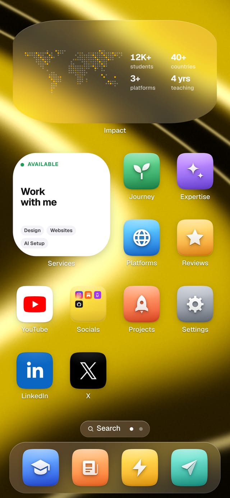
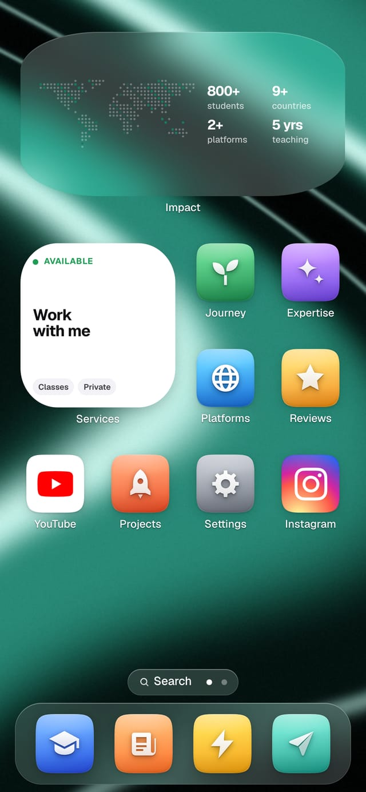
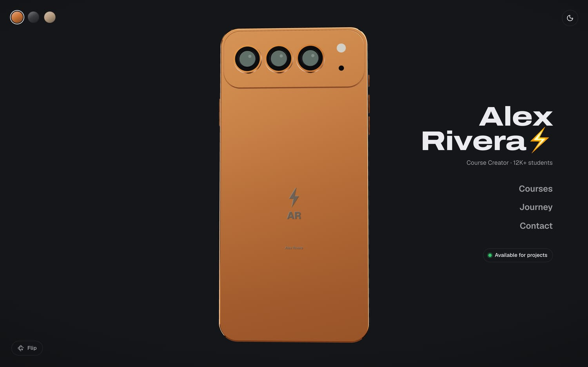
:::

::: step 4 | Review it in the browser
Start the site and open it:

```terminal
npm run dev
```

Open `http://localhost:3000` in your browser and click through this list. Note anything you want changed.

1. The lock screen: swipe up (or click) to open.
2. Your name and nav beside the phone; the green status pill.
3. Drag beside the phone to turn it over. Check your initials on the back. Click **Flip** to turn it back.
4. Open every app on page 1 and in the dock. Read every line for typos.
5. Swipe to page 2: GitHub heatmap, latest post, video.
6. Long-press an icon: make a folder, remove an app and add it back from the App Library. Then **Settings → Home Screen → Reset** puts your layout back.
7. Open Socials and click each icon: does it go to *your* profile?
8. Contact: the "To" address is yours.
9. Settings: switch dark mode, finishes and wallpapers.
10. Open the site on your phone too (Chapter 8 shows how, after deploying).

✅ You're done when every app shows your content and every link goes to your profiles.
:::

::: step 5 | Make changes with a fix list
Write what you want changed as a numbered list and paste it with the "Fix list" prompt below. Numbered lists work much better than one long paragraph, because Claude Code can tick them off one by one and you can refer to "number 3" later.
:::

## The "Fix list" prompt

Use this on either path, as often as you like.

```prompt 09-fix-list.md
Here is my fix list. Work through it in order, without asking me questions.
For each item: make the change, then check it in the browser with Playwright
(desktop 1440x900 and phone 390x844) and look at the screenshot.

1. {{FIRST_THING_TO_CHANGE}}
2. {{SECOND_THING_TO_CHANGE}}
3. {{THIRD_THING_TO_CHANGE}}

Rules:
- All visible text lives in content/*.ts. Don't hard-code text in components.
- Keep the originality rules: no copied code, text, images, icons or fonts from other sites.
- When you're done, run npm run lint && npm run typecheck && npm run build && npm test.
  If a visual test fails only because of my intended change, update that baseline with
  npx playwright test --update-snapshots and say which ones you updated.
- Commit with a clear message, then report item by item: done / not done and why.
```

✅ You're done when every item is marked "done" (or has a clear reason why not) and the checks pass.

::: tip
**Good fix-list items** say *where* and *what*: "On page 1, rename the Expertise app to Skills", "In Courses, put the Figma course first", "The photo in Journey is cropped too tight; show more of the shoulders". Add a screenshot path if you saved one: Claude Code can look at images.
:::

# Path B: From Scratch

This path rebuilds the whole site with the same seven prompts that built the original, cleaned up so they work for anyone. Run them in order, in an empty folder, each in the same Claude Code session if you can.

::: note
**Inspiration.** The interaction idea comes from Prasad Ware's portfolio, [prsd.dev](https://www.prsd.dev/). These prompts let you study a site you admire for how it *behaves* only. Never copy its code, text, images, icons, fonts or 3D models.
:::

Before you start:

1. Create an empty folder, for example `my-portfolio`, and put your `my-content.md` and `my-photos/` in it.
2. Replace every `{{PLACEHOLDER}}` in the prompts with your own details before you paste. They're in capitals so you can spot them.
3. Pick a reference site you admire for its *feel*, and put its address where a prompt says `{{REFERENCE_SITE_URL}}`. If you don't have one, delete those lines.
4. Expect to type `continue` a few times (see Chapter 9).

| Placeholder | Example |
|---|---|
| `{{YOUR_NAME}}` | Alex Rivera |
| `{{YOUR_ROLE}}` | Course Creator |
| `{{YOUR_ONE_LINER}}` | I make design and AI feel easy. |
| `{{YOUR_EMAIL}}` | hello@example.com |
| `{{YOUR_DOMAIN}}` | example.com |
| `{{YOUR_SITE_URL}}` | https://your-project.vercel.app (your live address, once it's online) |
| `{{YOUR_YOUTUBE_HANDLE}}` | @your_channel |
| `{{YOUR_OLD_SITE_URL}}` | https://old.example.com (or delete the line) |
| `{{YOUR_BLOG_RSS_URL}}` | https://yourname.substack.com/feed |
| `{{YOUR_GITHUB_USERNAME}}` | your GitHub username |
| `{{YOUR_INITIALS}}` | AR |
| `{{ACCENT_COLOR}}` | #FFB800 |
| `{{FINISH_1}}`, `{{FINISH_2}}`, `{{FINISH_3}}` | Electric, Graphite, Sand |
| `{{REFERENCE_SITE_URL}}` | a site you admire (behaviour only) |

## Prompt 1: the build spec

**What it does:** describes the whole site: layout, the phone OS, every app, the content files and the quality bar. It isn't pasted into Claude Code. You save it as a file, and the next prompt tells Claude Code to read it. **Time:** 10 minutes to fill in. **What you'll see:** nothing yet.

Save everything in this block as `pocket-portfolio-spec.md` in your project folder.

```prompt 03-build-spec.md
# Build spec: {{YOUR_NAME}}, "Pocket Portfolio"

## Role and goal
You are a senior front-end engineer and interaction designer. Build my personal website as an
interactive "pocket portfolio": the whole site is a phone home screen. Visitors explore my work
by opening apps on the phone: Courses, Journey, Expertise, Platforms, Projects, Blog, Reviews,
Services, Contact and Settings. On desktop the phone floats in the centre of a calm "studio"
backdrop, with my name and a short nav beside it. On a real phone the site becomes the phone:
a full-screen home screen with no device frame.

I'm {{YOUR_NAME}}, {{YOUR_ROLE}}. My line: "{{YOUR_ONE_LINER}}". The site should feel playful,
premium and simple.

Originality rules: design your own icon set, wallpaper and phone frame. Don't reuse any
company's trademarked app icons, and don't recreate the LinkedIn, X or YouTube interfaces.
Brand logos may appear only as small marks on links to my own profiles, following each brand's
guidelines. Don't copy code or assets from any other portfolio site.

## Source of my content
1. my-content.md (my worksheet) is the source of truth.
2. My old site {{YOUR_OLD_SITE_URL}} is mine: open it with Playwright, extract its text and links,
   and download my images. (Delete this line if I have no old site.)
3. My photos are in my-photos/. Convert all images to WebP.
4. Put everything in typed files in /content (see "Content model"). Never hard-code content in
   components. Never invent numbers, ratings, dates or quotes.

## Tech stack
- Latest stable Next.js (App Router) + TypeScript (strict), deployed on Vercel. Domain: {{YOUR_DOMAIN}}.
- Tailwind CSS with CSS custom properties for theme tokens.
- Motion (motion/react) for springs, shared-layout transitions and gestures.
- Zustand for OS state: open app, app stack, theme, phone finish and wallpaper.
- React Three Fiber + drei for a 3D phone on desktop, lazy-loaded; a CSS phone is the fallback.
- next/font with two free fonts: Inter or Geist for UI text, and Archivo (expanded) or
  Unbounded for my name.
- lucide-react for UI glyphs. App icons are custom SVGs.
- Resend for the contact form (to {{YOUR_EMAIL}}), with Zod validation.
- My blog RSS ({{YOUR_BLOG_RSS_URL}}), fetched server-side and revalidated every 6 hours, with
  static fallback posts in /content/blog.ts.
- Playwright for smoke and screenshot tests, plus ESLint and Prettier.

## Information architecture
One page. Each app has its own URL hash so links can be shared and the back button works:
#home #courses #journey #expertise #platforms #projects #blog #reviews #services #contact
#settings #socials (folder) #ask (optional AI app)
- Setting a hash opens that app with the launch animation. Going back (browser back, a swipe,
  or the in-app back chevron) returns to #home.
- document.title changes per app: "{App} - {{YOUR_NAME}}". Home: "{{YOUR_NAME}} - {{YOUR_ROLE}}".
- Loading a deep link opens that app directly, without flashing the home screen first.

## Layout
- Desktop (900px and up): full-viewport studio background with a subtle vignette, light and
  dark. Phone centred, height about min(88vh, 900px), soft shadow. On the right: my name in the
  display font on two lines, a muted one-liner, nav links (Courses, Journey, Contact) that open
  those apps, and a green "Available for projects" pill. Top-left: 3 round swatches for the
  phone finish ({{FINISH_1}}, {{FINISH_2}}, {{FINISH_3}}; {{FINISH_1}} uses {{ACCENT_COLOR}}),
  saved in localStorage (wrapped in try/catch).
- Tablet (600-899px): phone centred, name and nav as a bar below it.
- Mobile (under 600px): no frame and no studio. The home screen fills the viewport and respects
  env(safe-area-inset-*). Apps open full-screen.

## The phone OS
- Status bar: live clock, signal/wifi/battery glyphs in SVG, a pill-shaped camera cutout. Text
  colour adapts to the current app.
- Wallpaper: original, slowly animated glossy ribbons in the finish colour (a light fragment
  shader), with a CSS fallback. Pauses when the tab is hidden; static with reduced motion.
  Settings offers 3 presets.
- Home screen: a 4-column grid of rounded-square icons with labels. An "Impact" widget (4x2)
  with a dot-grid world map and 4 count-up stats from my worksheet. A "Work with me" widget
  (2x2) with 3 service chips, beside a 2x2 block of icons (Journey, Expertise, Platforms,
  Reviews). A row with YouTube, Socials (a folder), Projects and Settings. A frosted "Search"
  pill. A frosted dock: Courses, Blog, Services, Contact. The home indicator bar.
- Icons: one cohesive, original SVG set: soft gradient fill, one bold glyph, subtle highlight,
  its own colour per app.
- App launch and close (the signature interaction): the window expands from the tapped icon's
  position to fill the screen (scale and corner radius), the home screen behind scales to about
  0.92 and dims. Spring about stiffness 380, damping 34. Closing reverses it into the icon.
  Close with the back chevron, browser back, Esc, or a swipe up on the home indicator.
  Icons scale to 0.9 while pressed. With prefers-reduced-motion, everything becomes a crossfade.
- Spotlight: a frosted overlay with fuzzy search across apps, courses, posts, skills and
  services. Enter opens the result. Cmd/Ctrl+K opens it on desktop.

## Apps (all share one app shell)
Large 34px title and a back chevron; grouped list cards with hairline dividers; scrolling stays
inside the phone; pushed detail views slide in from the right.
1. Courses (or Products): filter chips by category, a featured card, a list with an Enroll/Open
   button, and a detail page per item (blurb and who it's for, from my worksheet only).
2. Journey: photo, name, role and location, up to 3 badges, "My story" in short paragraphs, a
   vertical timeline, education, and one highlight card.
3. Expertise: a grid of skill areas with tools as chips; tapping opens a sheet with related
   courses and services, cross-linked by id.
4. Platforms: where people find my work, each with an "Open profile" link.
5. Projects: cards with screenshot, tagline, tech used and a link; filter chips.
6. Blog: posts from RSS (date, title, subtitle, image); a reader view with the excerpt and a
   "Read the full post" button. Never show the full article text.
7. Reviews: show a review only if verified is true in /content/reviews.ts. Every review starts
   as verified: false. With none verified, show "Stories coming soon".
8. Services: large cards with a "Let's talk" button that opens #contact with the subject
   pre-filled, plus "Why people trust me" lines.
9. Contact: a compose-mail view (To: {{YOUR_EMAIL}} read-only, from, name, subject, message).
   POST to /api/contact via Resend, Zod validation, a honeypot field, 3 messages per hour per IP.
   Without a Resend key, show "email me directly". Paper-plane send animation.
10. Settings: profile row; Accessibility (Reduce motion, Larger text); Display (Light/Dark with
   two mini previews, which changes both the apps and the studio); Wallpaper; Phone finish;
   About (tech used and credits).
11. Socials folder: a folder overlay with my profiles; each opens in a new tab (rel="noopener").
12. Optional Ask app, last: a chat answered by an LLM through a server route, grounded only in
   /content, refusing off-topic requests, rate-limited, behind NEXT_PUBLIC_ENABLE_ASK=true.

## Theming
Tokens on :root and .dark for the studio (bg, ink, muted, line) and the apps (background,
surface, group, ink, secondary, muted, divider, glass), plus --accent set by the finish.
Light studio about #FAFAFA with ink #29292B; dark about #151619 with ink #ECECEE. Glass:
backdrop-filter blur(20px) saturate(160%). Set the theme before first paint (no flash).
Animate theme changes as a circular reveal with the View Transitions API where supported.

## Content model (/content/*.ts, each with a Zod schema and typed exports)
profile.ts (name, role, bio, story, location, education, email, avatar, socials, github, stats),
timeline.ts, courses.ts, platforms.ts, projects.ts, expertise.ts, services.ts, philosophy.ts,
blog.ts (fallback posts), reviews.ts, apps.ts (home-screen and dock layout).
Write CONTENT.md explaining how to edit each file and where images go.

## Quality bar
- Performance: Lighthouse mobile 90+ and desktop 95+; initial JS under 200 KB gzipped; apps and
  the 3D phone loaded with dynamic(); images through next/image.
- Accessibility: every icon is a real button or link with an accessible name; app windows are
  dialogs with focus trapped and returned to the icon on close; arrow keys move around the grid;
  visible focus rings; WCAG AA contrast in both themes; honours prefers-reduced-motion.
- SEO: OpenGraph and Twitter cards with a generated OG image, sitemap.xml, robots.txt, JSON-LD
  Person, and a visually hidden semantic summary in the server HTML.
- Resilience: RSS and the contact API fall back gracefully. No secrets in the client.
  .env.example lists every variable.
- Code: strict TypeScript, no any, small components, shared motion presets in lib/motion.ts.

## Build plan (phases; check each before moving on)
1. Scaffold: Next.js, Tailwind, tokens, fonts, flash-free theme toggle.
2. Content import into /content, images optimised, Zod validation.
3. Studio and CSS phone: swatches, side column, arrival animation, breakpoints.
4. OS shell: status bar, wallpaper, home grid, widgets, dock, icons, hash router, app window
   with launch/close and swipe-to-close, Socials folder.
5. Apps: Courses, Journey, Services, Contact, Blog, Expertise, Platforms, Projects, Reviews,
   Settings.
6. Spotlight, keyboard navigation, focus management, reduced motion.
7. 3D phone (procedural, my {{YOUR_INITIALS}} mark on the back), then the optional Ask app.
8. Polish: SEO, OG image, Lighthouse pass, Playwright tests (open/close every app, theme toggle,
   contact validation, deep links), README with Vercel deploy steps.
After each phase: run npm run lint && npm run build and fix errors; take Playwright screenshots at
1440x900, 834x1112 and 390x844 in both themes and fix anything that looks off; commit; give me a
3-line summary.

## Definition of done
Desktop shows the studio, the phone, my name and nav. A phone shows a full-screen home screen.
Every app opens from its icon with the zoom animation, has a working hash deep link, and closes
with back, Esc or a swipe. All content comes from /content. Theme and finish survive a reload.
Only verified reviews show. Lint, type-check, build and tests pass; Lighthouse targets are met.
```

✅ You're done when `pocket-portfolio-spec.md` is saved in your project folder, with every placeholder filled in.

## Prompt 2: the master prompt

**What it does:** sets up the toolbox, opens a browser, studies your reference site for behaviour, then starts building phase by phase. **Time:** the first phase takes 30–60 minutes. **What you'll see:** a tools table, a short plan, then Phase 1 (an empty studio page with a working theme toggle).

```prompt 04-master-prompt.md
You're building my new personal website. The complete build spec is in
./pocket-portfolio-spec.md. Read it fully before doing anything else. It's the source of truth
for the design, the features, my content, the build phases and the definition of done.

Step 0: take stock of your tools.
List every skill, plugin and MCP server installed (~/.claude/skills, ./.claude/skills, /plugin,
claude mcp list, CLAUDE.md files). Give me a short table: Name | What it does | Will you use it
here? (yes/no + why). Use every relevant one at the right moment without waiting for me.

Step 1: make sure these are installed (check first; install only from these official sources;
ask me before any global install):
A) Context7 (https://github.com/upstash/context7): "npx ctx7 setup --claude" in MCP mode, or
   claude mcp add --transport http --scope project context7 https://mcp.context7.com/mcp
   Add to ./CLAUDE.md: "Always use Context7 when you need library/API docs, code generation,
   setup or configuration steps." Look up current docs before using Next.js, Tailwind, Motion,
   Zustand, React Three Fiber, drei, next/font, Resend, Zod and Playwright. Don't guess APIs.
B) A browser: Claude in Chrome if it's connected (/chrome), otherwise the Playwright MCP:
   claude mcp add playwright npx @playwright/mcp@latest

Step 2: browser work.
1. Open my reference site {{REFERENCE_SITE_URL}} at 1440x900 and 390x844. Study how it behaves
   and feels: timing, springs, depth, blur, spacing. Write plain-language behaviour notes in
   docs/reference-notes.md. Keep any screenshots in docs/reference/ (add it to .gitignore);
   they're for your eyes only.
   Strict rule: never copy its source code, text, images, icons, 3D model or fonts. It belongs
   to someone else. It's a reference for how things feel, not material to reuse.
2. Read my content exactly as the spec's "Source of my content" section says.
3. After every phase, open my site locally and click through every app, the open/close
   animation, the back button, Esc, the theme switch and the contact form. Fix anything that's
   off before you report back.
4. Browser safety: never type passwords, API keys or payment details into any site; never submit
   a form on someone else's site; if a login or captcha appears, stop and tell me.

Step 3: build.
Follow the build phases in the spec, in order. After each phase: run npm run lint && npm run
build and fix errors; take Playwright screenshots at 1440x900, 834x1112 and 390x844 in both
themes and review them yourself; commit with a clear message; give me a 3-line summary.

Ground rules:
- Plan first: before Phase 1, show me a short plan (tools, skills, open questions). All my
  content is in my-content.md, so ask only what's truly missing.
- Originality: the icons, wallpaper, phone and all copy (apart from my content) are original.
- All content lives in /content/*.ts. Every review stays verified: false until I confirm it.
- Secrets live in .env.local only. Keep .env.example up to date.
- When something fails (a tool won't install, a site blocks you), tell me plainly, use the next
  best option, and keep going.

Start now with Step 0.
```

✅ You're done when Claude Code has shown its tools table and plan, finished Phase 1, committed it, and given you a 3-line summary.

## Prompt 3: run all phases without stopping

**What it does:** lets Claude Code carry on through phases 2 to 8 without waiting for you to say "next" each time. **Time:** several hours; you can leave it running. **What you'll see:** a 3-line summary and a commit after each phase.

```prompt 05-run-all-phases.md
The plan looks good. Run all the remaining phases (2 to 8) without stopping and without waiting
for me to say "next". Don't ask me questions: if something needs my input (keys, accounts,
decisions), pick a sensible default, add it to a "Needs me" list in docs/progress.md, and keep
going. After each phase, still run the checks, review the screenshots, commit, and add 2-3
lines to docs/progress.md. When everything is done, give me one report: what was built, the
Lighthouse scores, the test results, the "Needs me" list, and how to run the site.
```

✅ You're done when all 8 phases are committed, `npm test` passes, and you have the final report. Open the site with `npm run dev` and try it.

## Prompt 4 (v3): a real 3D phone that feels like a smartphone

**What it does:** turns the phone into a real 3D object you can turn over, and rebuilds every interaction around springs and gestures: lock screen, two home pages, interactive close, switcher, Control Center, PWA. **Time:** 4–8 hours. **What you'll see:** 9 commits, one per step, and a before/after table in `docs/feel-gap.md`.

```prompt 06-v3-3d-phone.md
The site works, but I want it to look and feel much more like a real phone:
1. A real 3D phone on desktop by default: I can turn it over to see its back, and it reacts
   to my mouse.
2. Every tap, swipe, open, close, scroll and back gesture is smooth, physical and
   interruptible, with springs and gestures like a real phone.

Work on the existing project and keep /content, the tests and the APIs. Create the branch
feat/v3-3d-phone. Work autonomously; don't ask me anything. Anything that needs me goes on the
"Needs me" list in docs/progress.md.

0. Toolbox. Re-inventory skills, plugins and MCP servers. Use emil-design-eng, animate,
   apple-design and impeccable for motion craft; web-design-guidelines and
   vercel-react-best-practices; Context7 before writing code with @react-three/fiber,
   @react-three/drei, three, motion/react or Next.js; Playwright (or Claude in Chrome) to look.

1. Study the reference with recordings. Record Playwright videos (recordVideo) of these on
   {{REFERENCE_SITE_URL}} and on my local build: first load, hover/parallax, drag-rotating the
   phone and letting go, opening/closing 3 apps, scrolling in an app, a detail view and back,
   theme and finish, search, mobile. Write docs/feel-gap.md as a table: Interaction | Reference
   behaviour (plain words) | Mine now | Gap | Fix. Measure durations, spring vs fixed curve,
   whether animations can be interrupted, and long tasks. Use it as your to-do list.

2. Originality rules (non-negotiable): use the reference only for how it behaves. Don't copy
   any of its code, text, images, icons, fonts, 3D model or wallpapers. Don't build or download
   a model of a real phone product, and use no brand logo or brand camera layout. Model an
   original premium phone yourself, in code. No trademarked app icons or fonts. Generic
   smartphone patterns (springs, swipe-home, app switcher, edge-swipe back, rubber-banding,
   control panel, notification banners) are fine; build your own versions.

3. The 3D phone (on by default at 900px and up with WebGL; CSS phone when WebGL is missing,
   the 3D code errors, or Reduce motion is on):
   - Procedural body in R3F: rounded slab with a soft bevel, glossy metal frame, satin glass
     back, thin even bezels. The live HTML screen sits on it with drei <Html transform
     occlude="blending">, so it hides when the back faces the camera, stays crisp and clickable.
   - An original camera module on the back, and my {{YOUR_INITIALS}} mark debossed in the centre.
   - Small original side buttons. Materials from the finish colour, blended over 400ms.
   - Lighting from drei <Environment> with <Lightformer>s (no HDR downloads), contact shadows,
     ACES or AgX tone mapping, correct colour space so screen colours match the CSS phone.
   - Arrival: one spring rise and turn-in, the screen wakes about 150ms after it lands.
   - Drag on the stage beside the phone to turn it (never from the screen); a small pointer
     parallax; the phone faces the camera while I use the screen. frameloop="demand", pause
     when the tab is hidden, ErrorBoundary falls back to the CSS phone with no layout shift.

4. The OS feels like a phone. Every animation is interruptible; animate only transform,
   opacity, clip-path and filter.
   - lib/motion.ts: named springs (snappy 500/40, smooth 300/32, gentle 170/26, launch 380/34,
     home 420/36) and a rubber-band helper (1 - 1/(x*c/d + 1)) * d. Pass gesture velocity into
     springs.
   - Lock screen once per session: clock, date, a notification for my latest post, swipe up
     with rubber-banding (past 30% or a fast flick unlocks); icons fly in with a 20ms stagger.
     Deep links skip it.
   - Home: two pages with dots (page 2: latest post, latest video, skills widgets), paging with
     velocity and rubber-band, trackpad and arrow keys; pull down anywhere for Search; icon press
     0.92 on snappy; long-press 500ms for jiggle mode with drag-to-rearrange (saved); frosted dock.
   - Launch grows from the exact icon rect on the launch spring, icon art crossfades in the
     first 40%, home recedes to 0.9 with dim and blur. Close by swiping up on the home indicator,
     fully interactive (follows the finger, shrinks to 0.6, flies back into the icon with the
     release velocity). Swipe up and hold for an app switcher. Esc, back and the chevron use
     the same fly-back.
   - In apps: large titles collapse into a frosted bar by scroll position; rubber-band overscroll
     on wheel and touch; pushed views shift the parent -30% with an interactive edge-swipe back;
     sheets with medium/large detents; swipe-left row actions; pull-to-refresh on Blog.
   - System UI: a status pill around the camera cutout that morphs for events ("Message sent",
     "Link copied", "Theme: Dark", a progress ring); Control Center from the top-right corner
     (dark mode, finish, wallpaper, reduce motion, larger text, brightness, now playing); one
     notification banner per session.
   - Accessibility stays first-class: every gesture has a button or key; focus trap and return
     still work; reduced motion means CSS phone and crossfades.

5. Mobile (under 600px): the OS is full-screen with 100dvh and safe areas, correct touch-action
   per region, overscroll-behavior: none, no conflict with the browser's own swipe-back, and an
   installable PWA (manifest, icons, display: standalone).

6. Performance budget (measure, don't guess): the 3D chunk loads after the home screen paints;
   initial JS at most 200 KB gzipped; no long tasks over 50ms during launch/close, page swipes,
   rotation or the switcher; Lighthouse desktop 95+, mobile 90+, and 100 for accessibility,
   best practices and SEO.

7. Process, one commit per step: (1) recordings + feel-gap table, (2) motion system and gesture
   helpers, (3) the 3D phone, (4) launch/close + switcher, (5) lock screen, 2-page home, search,
   jiggle, (6) in-app physics, (7) system UI, (8) mobile + PWA, (9) performance and accessibility
   pass, then re-record and add "After" notes to docs/feel-gap.md.
   After every step: npm run lint && npm run typecheck && npm run build && npm test; add tests
   for new gestures (Playwright mouse/touchscreen drags, assert the end state); record a short
   video, extract frames with ffmpeg and fix anything that jumps or flickers; add 2-3 lines to
   docs/progress.md.

When finished, give me one report: what changed, before/after notes, Lighthouse scores, test
results, the "Needs me" list, and how to run it.
```

✅ You're done when the desktop shows a 3D phone you can turn over, apps close by swiping the home bar into their icon, the lock screen unlocks with a swipe, and all tests pass.

## Prompt 5 (v4): stable phone, brand icons, GitHub heatmap, polish

**What it does:** fixes the most common problem after v3 (the phone moves when you click it), makes the phone look like a premium flagship, uses official brand marks for social links, and adds the GitHub heatmap. **Time:** 3–6 hours. **What you'll see:** 5 commits, 27 new stability tests, and screenshots of all finishes.

```prompt 07-v4-polish.md
Work on a new branch, feat/v4-polish. Work autonomously; don't ask me questions. Anything that
needs me goes on the "Needs me" list in docs/progress.md. Use Context7 for R3F/drei/three/motion
docs, my design skills (emil-design-eng, animate, apple-design, impeccable,
web-design-guidelines), and Playwright to compare against {{REFERENCE_SITE_URL}} (behaviour only).

Problem 1 (most important): the phone must never move when I click it.
First reproduce it: a Playwright test that clicks, double-clicks and jitters (1-5px) on the
screen, the frame and the stage beside the phone, clicks an app icon and clicks fast, and
asserts the rotation stays 0 and the phone's box doesn't move (0.5px tolerance). Then fix it:
- Rotate only on a deliberate drag that starts on the stage outside the screen (never on
  anything pressable), moves more than 12px, and moves more sideways than up/down.
- Rotation follows the pointer 1:1. On release, project the velocity a little (at most 90
  degrees), then settle on the nearest face (0 or 180) with a critically damped spring (no
  overshoot, about 450ms), and stay there. No idle return, no tap-to-flip, no idle float.
  Put an explicit "Flip" button in a studio corner.
- Pitch during a drag at most 12 degrees, back to 0 on release.
- Parallax at most 3 degrees, eased slowly, and off while the pointer is over the screen, while
  any app is open, and for 600ms after any click.
- Regression tests: 200px drag ends at 180, drag again ends at 0, a 30px drag settles at 0.

Problem 2: make the phone look like a premium current large-screen flagship (front first).
- Proportions about 77.5 x 163.5 x 8.8 mm, corner radius about 12.5% of the width; thin, even,
  pure-black bezels (about 1.4% of the width) with concentric display corners; a pill cutout
  about 30% of the screen width and 3.6% of its height.
- Flat sides with a thin polished chamfer, brushed metal walls, a crisp edge highlight from
  Lightformer placement; slim, precisely placed side buttons; a faint glass sheen on the screen.
- A device-like status bar: time on the left, indicators on the right, aligned beside the pill.
- Finishes that look like anodized metal, not plastic: lower saturation, higher metalness.
- Back: an original wide camera plateau with three lenses, flash and sensor, my
  {{YOUR_INITIALS}} mark in the centre, no brand logos.
- Keep modelling it yourself in code. Don't download any phone model.
Check screenshots at 1440x900, front and back, all 3 finishes, both themes, and keep iterating
until it looks premium.

Problem 3: official brand marks for social links, polished original icons for my apps.
- Every brand link (LinkedIn, X, YouTube, Instagram, GitHub, my newsletter and course
  platforms) shows that brand's official mark from the simple-icons npm package (CC0) on a tile
  in the brand's colour, never distorted or recoloured outside its guidelines. (If a mark isn't
  in simple-icons, use Font Awesome Free and credit it, CC BY 4.0.) Put LinkedIn and X straight
  on home page 1. These link to my profiles only.
- My own app icons stay original (don't copy any system app icons) but as polished as real
  system icons: 2-3 stop gradients, soft top highlight, subtle inner shadow, glyphs with weight
  and a slight shadow, a true superellipse mask, consistent optical sizing. Check at 60px and
  180px.

Problem 4: a GitHub contribution heatmap at the top of home page 2.
- My username is {{YOUR_GITHUB_USERNAME}}; store it in content/profile.ts as github.
- getContributions(): GraphQL contributionCalendar when GITHUB_TOKEN is set, otherwise parse the
  public https://github.com/users/<user>/contributions page; cache 6h with "use cache"; if both
  fail, an empty grid with "View on GitHub".
- A full-width widget: the last ~17 weeks as rounded squares in 5 greens that work in light and
  dark, the GitHub mark, my username and the total; today's square pulses softly; columns fade
  in the first time page 2 is in view; tapping opens my profile; an accessible label like
  "GitHub: 312 contributions in the last year". Page 2 must fit without scrolling at 390x844.

Also: compare the home screen with the reference for quality only (icon size and rhythm, label
size and shadow, widget corners, frosted dock, Search pill, wallpaper richness) and close the
gap with my own content, icons and wallpaper.

Process: Problem 1 first, then 4, 3, 2, then the polish. After each: lint, typecheck, build,
test; screenshots and video at 1440x900 and 390x844, reviewed frame by frame; commit; 2-3 lines
in docs/progress.md. Keep initial JS at most 200 KB gzipped and no long tasks. Report what
changed, screenshot paths, test results and the "Needs me" list.
```

✅ You're done when clicking anywhere never moves the phone, a drag turns it and it stays on the face where it settles, the social links show the real brand marks, and page 2 shows your GitHub heatmap.

## Prompt 6: the "Fix list"

Use the same "Fix list" prompt as Path A (Chapter 6). It works the same way on a site you built from scratch. Run it as many times as you like.

## Prompt 7 (v5): fit every phone, home-screen editing, speed

**What it does:** makes the home screen fit any phone and browser by working out the grid from the space it really gets, adds real home-screen editing (folders, removing apps, an App Library, dock editing, reset), and makes apps open instantly with prefetching and a service worker. Run it after Prompt 5, once your site is online, and check the result on your own phone. **Time:** 4–8 hours. **What you'll see:** 3 commits (one per problem), a contact sheet of screenshots at 17 screen sizes, and a before/after speed table in `docs/v5/speed.md`.

```prompt 08-v5-mobile-speed-folders.md
I opened my live site ({{YOUR_SITE_URL}}) on my phone and found three problems. Fix all of them
on a new branch, feat/v5-mobile, created from main. Work autonomously; don't ask me questions.
Anything that needs me goes on the "Needs me" list in docs/progress.md. Use Context7 for
Next.js, Motion, use-gesture and Serwist docs before writing code; use my design and motion
skills; use Playwright for device emulation, traces and videos.

First write failing Playwright tests that reproduce problems 1 and 2, using the device matrix
below and a 4x CPU-throttled phone profile. Then fix them.

Problem 1: fit every phone, every browser, every orientation. Nothing on the home screen, lock
screen, an app or a system panel may ever be clipped or hidden behind browser toolbars.
1. Use the real visible height: 100dvh (falling back to 100svh, then 100vh), plus
   window.visualViewport written to a --vvh CSS variable. Respect all four
   env(safe-area-inset-*) with viewport-fit=cover, and interactive-widget=resizes-content so
   the Contact form stays visible with the keyboard open.
2. Calculate the home-screen grid from the space available, in a useHomeLayout() hook:
   columns (4 on phones, 3 below 340px, 5-6 on tablets and landscape), icon size
   min(width-based, height-based) clamped to 48-68px with labels and gaps scaling, and how
   many rows fit.
3. Overflow goes to the next page like a real phone: items fill pages in order, widgets take
   whole cells (Impact 4x2, Work with me 2x2, GitHub 4x2, Blog 4x2, YouTube 2x2, Expertise
   stack 2x2), page dots appear automatically. Never shrink icons below 48px. Under 600px of
   usable height, large widgets move to their own page.
4. With no latest video, the YouTube widget shows a proper channel card: the YouTube logo,
   {{YOUR_YOUTUBE_HANDLE}} and "Watch on YouTube". The Expertise stack is a real stacked-cards
   widget that never overflows.
5. The lock screen, apps, Control Center, app switcher, sheets, Spotlight, banner and status
   pill all use the measured height and safe areas. App content scrolls with nothing under
   the home indicator.
6. Landscape on phones must not break: a rotate hint or a 6-7 column home screen, whichever
   looks better. Stop Android text auto-zoom (text-size-adjust: 100%), match the theme-color
   meta to the wallpaper, and never let the page itself scroll or bounce.

Device matrix (tests and screenshots for every one): 320x568, 375x667, 375x812, 393x852,
430x932, 390x664 (Safari with toolbar), 412x915, 412x780 (Chrome with toolbar), 392x690 (Brave
with toolbars), 360x740, 360x800, 360x640, 280x653 and 673x841 (a folding phone), 744x1133,
844x390 and 740x360 (landscape). For every size: every icon, label and widget sits fully
inside the visible area above the Search pill and dock with at least 8px margin (assert with
bounding boxes); nothing clips (scrollHeight <= clientHeight); every app scrolls to its last
element above the home indicator; with the viewport 300px shorter (keyboard), the focused
Contact field and Send stay visible. Save light and dark screenshots to docs/v5/fit/, make a
contact sheet and look at all of it yourself. Also run WebKit with the iPhone presets. Put "test
on a real iPhone Safari, Samsung Internet and the LinkedIn/Instagram in-app browsers" on the
"Needs me" list.

Problem 2: apps must feel instant. Targets on a 4x throttled phone with Fast 4G: tap to first
reaction 50ms or less; the window starts expanding within one frame and never waits on the
network; title and first content readable within 250ms; launch settles by 380ms, close by
300ms, app switching by 450ms; 60fps swipes and scrolling; no long tasks. Repeat visits load
almost instantly from cache.
1. Find the real cause first: record a trace (cold load, open and close Journey, Courses, Blog)
   and write where the time goes, with numbers, to docs/v5/speed.md.
2. Never wait for code on tap: prefetch every app's chunk when the home screen is idle
   (requestIdleCallback, 1500ms timeout) and again on pointerdown of its icon. If a chunk still
   isn't ready, the launch runs anyway with the skeleton and the content fades in.
3. Make the launch cheap: no filter: blur() during launch on phones (opacity and scale only),
   no backdrop-filters under the animating window while it moves, contain: layout paint on
   app screens.
4. Fast first renders: above-the-fold first, content-visibility: auto for long lists, correct
   image sizes, priority only for the first visible image.
5. Tune the launch spring to about 350ms and the close to about 280ms, readable by 40%
   progress, always interruptible.
6. Add a service worker with Serwist (the serwist package; @serwist/next needs webpack, so
   bundle sw/sw.ts with esbuild after next build): cache the app shell, chunks, fonts and
   icons; stale-while-revalidate for RSS, GitHub and YouTube data; it must not break the dev
   server, and new deploys activate on the next load.
7. Keep the budgets: initial JS at most 200 KB gzipped, Lighthouse mobile 92+ and desktop 100.
Add tests/speed.spec.ts (CPU throttled via CDP) as its own Playwright project that runs last
and alone, one test at a time (throttled browsers side by side double every number): open 5
apps from a fresh load; the window moves within 50ms of the click, the title shows within
400ms, and no chunk request happens after the tap. Put the before/after timing table in
docs/v5/speed.md.

Problem 3: real home-screen editing, saved per visitor in localStorage (versioned key, with a
migration from the current icon order).
- Edit mode: long-press an icon or an empty spot for 500ms. Icons wiggle, removable ones show
  a "-" badge, a "Done" pill shows top-right and a "+" top-left opens the App Library. Outside
  edit mode, a long-press opens a frosted context menu: Open, Share (brand links), Edit Home
  Screen, Remove App.
- Folders: drag one app onto another and hold about 400ms to make a folder with a default
  name from their category (Social, Learn, About Me, Work, or "Folder"); drag more apps onto
  it to add them; tapping zooms it open (3x3 grid, pages past 9, home screen blurred behind);
  tap the title in edit mode to rename; drag an app out past the folder's edge to put it back
  on the home screen; a folder with one app left dissolves. The Socials folder becomes a
  regular folder that exists by default.
- Remove: the "-" badge opens a sheet with "Remove from Home Screen" (the app stays in the App
  Library) and Cancel; the icon shrinks away and neighbours reflow on springs. Settings can't
  be removed, so people can always get things back.
- App Library: a sheet (from "+" in edit mode and Settings > Home Screen) listing everything
  not on the home screen; tapping one adds it to the first free slot. Settings > Home Screen
  > "Reset Home Screen Layout" restores the default, with a confirm sheet.
- Dock: in edit mode, drag apps into or out of the dock (at most 4 items; folders allowed).
- Feel and access: drags follow the finger, other icons make room on springs, holding at an
  edge for about 600ms changes page. In edit mode, arrow keys move the focused icon, Delete
  removes it, F makes a folder with the next icon, and screen readers announce each change.
  Reduced motion turns wiggle and springs into fades.
- Load the editor as its own chunk, fetched at idle with the apps, so a press never requests
  script during a launch and tests/speed.spec.ts still passes.
- Tests (tests/home-edit.spec.ts, mouse and touch): create, rename, add a third app, drag one
  out, dissolve, remove and restore from the App Library, drag into the dock, reset, persist
  across a reload, and still fit at 320x568 and 392x690 with everything added back.

Process: Problem 1, then 2, then 3. After each: npm run lint && npm run typecheck && npm run
build && npm test, review the device-matrix screenshots and video, commit, and add 2-3 lines to
docs/progress.md. When finished, fast-forward main and push so Vercel deploys, then run the
device-matrix screenshots and the speed test against {{YOUR_SITE_URL}}. Report what changed,
the before/after speed table, the contact sheet paths, test results and the "Needs me" list.
```

✅ You're done when nothing is cut off at any size in the matrix (including your own phone), apps start opening in the same frame as the tap, and you can make a folder, remove an app and bring it back from the App Library.


# Put it online

## 1. Push to GitHub

If you used **Use this template**, your repo already exists: push your changes. If you started from a ZIP or from scratch, create an empty repository on [github.com/new](https://github.com/new) first (no README), then ask Claude Code:

```prompt
Connect this project to my GitHub repository https://github.com/YOUR-USERNAME/my-portfolio
and push it. Make sure .env.local and any other secrets are NOT committed (check .gitignore
first and show me git status before pushing). If the push times out, push one branch at a
time and tell me what you did.
```

✅ You're done when your files show up on your GitHub repository page.

## 2. Fast-forward to main

Path B builds on branches (`feat/pocket-portfolio`, `feat/v3-3d-phone`, `feat/v4-polish`). Vercel deploys `main`, so bring `main` up to your latest branch:

```terminal
git checkout main
git merge --ff-only feat/v4-polish
git push origin main
```

✅ GitHub shows your latest commit on `main`. (Path A users are already on `main`.)

## 3. Deploy on Vercel

1. Go to [vercel.com/signup](https://vercel.com/signup) and sign up with your GitHub account.
2. Open [vercel.com/new](https://vercel.com/new). *(Screen: a list of your GitHub repositories.)* If yours isn't listed, click **Adjust GitHub App Permissions** and allow it.
3. Click **Import** next to your repository. *(Screen: "Configure Project", with Framework Preset showing Next.js.)*
4. Leave the build settings as they are. Open **Environment Variables** only if you have keys now (you can add them later).
5. Click **Deploy**. *(Screen: a build log, then confetti and a preview of your site.)*
6. Click **Continue to Dashboard**, then **Visit**. Your site is live at `your-project.vercel.app`.

✅ You're done when the vercel.app address shows your phone. Every `git push` to `main` now redeploys it automatically.

## 4. Environment variables

All of them are optional: the site works without any. Add them in Vercel under **Settings → Environment Variables**, then redeploy (**Deployments → ⋯ → Redeploy**).

| Variable | Used for | Without it |
|---|---|---|
| `RESEND_API_KEY` | Contact form email via Resend (server only) | Form shows "email me directly" |
| `CONTACT_TO_EMAIL` | Where contact messages go | `profile.email` |
| `CONTACT_FROM_EMAIL` | Sender on a domain verified in Resend, e.g. `Your Name <hello@yourdomain.com>` | `onboarding@resend.dev` (Resend test sender) |
| `NEXT_PUBLIC_ENABLE_ASK` | `true` shows the Ask app | Hidden |
| `OPENAI_API_KEY` | Ask app answers (server only) | App shows "email me directly" |
| `OPENAI_MODEL` | Model for the Ask app | `gpt-5-mini` |
| `GITHUB_TOKEN` | GitHub heatmap via GraphQL; a fine-grained token with no permissions is enough (server only) | Parses the public contributions page |
| `NEXT_PUBLIC_SITE_URL` | Canonical URL for SEO, sitemap and OG images | `VERCEL_PROJECT_PRODUCTION_URL` (set by Vercel), then `site.url` in `content/profile.ts` |

::: warning
`NEXT_PUBLIC_*` values are built into the page, so redeploy after changing them, and never put a secret in a `NEXT_PUBLIC_` variable. Keep real keys in Vercel and in `.env.local` on your computer only. Never commit them.
:::

## 5. Contact form with Resend

1. Create an account at [resend.com](https://resend.com) and open **API Keys → Create API Key**.
2. Add it to Vercel as `RESEND_API_KEY` and redeploy.
3. Send yourself a test from your site's Contact app. Without a verified domain, Resend's test sender (`onboarding@resend.dev`) can only deliver to the email you signed up with, which is fine if that's your `profile.email`.
4. To send from your own domain, add it under **Domains** in Resend, add the DNS records it shows at your domain provider, wait until it says **Verified**, then set `CONTACT_FROM_EMAIL` (for example `Your Name <hello@yourdomain.com>`).

✅ The test message arrives in your inbox.

## 6. GitHub token (optional, public read-only)

The heatmap works without a token. A token makes it more reliable, because the fallback reads GitHub's public page, whose layout could change.

1. On GitHub: profile picture → **Settings → Developer settings → Personal access tokens → Fine-grained tokens → Generate new token**.
2. Name it "portfolio heatmap", pick an expiry, set **Repository access** to **Public repositories**, and add **no permissions**. Every fine-grained token can already read public data.
3. Click **Generate token**, copy it, add it to Vercel as `GITHUB_TOKEN` and redeploy.

✅ Page 2 still shows your heatmap. (It refreshes every 6 hours.)

## 7. Custom domain and DNS

1. Buy a domain from any registrar.
2. In Vercel: your project → **Settings → Domains → Add**, and type your domain.
3. Vercel shows the DNS records to add (usually an `A` record for `yourdomain.com` and a `CNAME` for `www`). Add exactly those at your registrar's DNS settings.
4. Wait until Vercel shows **Valid Configuration** (minutes to a few hours). HTTPS is set up for you.
5. Set `site.url` in `content/profile.ts` (or `NEXT_PUBLIC_SITE_URL`) to `https://yourdomain.com`, push, and let it redeploy.

✅ `https://yourdomain.com` opens your site with a padlock.

## 8. Add to the Home Screen

- **iPhone (Safari):** open your site → **Share** → **Add to Home Screen** → **Add**.
- **Android (Chrome):** open your site → **⋮** menu → **Add to Home screen** (or **Install app**).

✅ The icon opens your portfolio full screen, without the browser bar, like an app.

# Troubleshooting

Every problem here really happened while building the original site. Each one is *Symptom → Why it happens → What to type or do*.

::: trouble
**"API Error: Can't reach the API server — check your internet or DNS (ENOTFOUND)"**

**Why:** your connection dropped for a moment, so Claude Code couldn't reach the server. Your work is safe.

**Do:** check your Wi-Fi, then type `continue` and press Enter. It picks up where it stopped.
:::

::: trouble
**Claude Code says you've reached your usage limit**

**Why:** every plan has a usage limit per time window, and long autonomous builds use a lot.

**Do:** wait until the time it shows, then type `continue`. Nothing is lost. To use less, keep one long session per prompt instead of starting many new ones.
:::

::: trouble
**It keeps asking "Do you want to make this edit?"**

**Why:** the default permission mode asks before every file change.

**Do:** press **Shift+Tab** until the status bar shows `⏵⏵ accept edits on`. Use `/permissions` to always allow specific safe commands (like `npm run build`), so it stops asking for those too.
:::

::: trouble
**Clicking the phone makes it spin**

**Why:** a real click often wobbles 5–10 px. With a small drag threshold and free-spinning inertia, that wobble counted as a "flick".

**Do:** this is Problem 1 in Prompt 5. The fix: rotate only on a deliberate sideways drag of more than 12 px that starts beside the screen; on release, settle on the nearest face with a critically damped spring and stay there; no idle float; parallax off over the screen and for 600 ms after any click. The template already has this fix and 27 tests for it.
:::

::: trouble
**You change a CSS rule but the built site still shows the old style**

**Why:** in Next.js 16, Turbopack keeps a build cache on disk, and it kept serving an old `globals.css`.

**Do:** turn the cache off for builds in `next.config.ts` (the template already does):

```ts
experimental: { turbopackFileSystemCacheForBuild: false },
```
Or delete the `.next` folder and build again.
:::

::: trouble
**"Error: listen EADDRINUSE: address already in use :::3100"**

**Why:** an old server (often from an earlier session) is still running on that port. Tests then talk to the *old* site.

**Do:** find and stop it, then start again:

```terminal
lsof -iTCP:3100 -sTCP:LISTEN
kill $(lsof -tiTCP:3100 -sTCP:LISTEN)
```
Or run on another port: `PORT=3200 npm test`. Port 3000 was taken by another project on our machine, which is why our scripts use 3100.
:::

::: trouble
**`git push` fails: "error: RPC failed; HTTP 408 ... the remote end hung up unexpectedly"**

**Why:** a slow or unstable connection timed out while uploading a big push (screenshots, the whole history at once).

**Do:** raise git's buffer for this repo and push one branch at a time:

```terminal
git config http.postBuffer 524288000
git config http.version HTTP/1.1
git push -u origin main
```
If it still times out, ask Claude Code to push a few commits at a time.
:::

::: trouble
**A push loop pushes nothing, or the wrong thing, in zsh**

**Why:** in zsh (the Mac's default shell), `$c:refs/heads/main` reads `:r` as a "remove extension" modifier, so the refspec is silently mangled.

**Do:** always wrap the variable in braces: `git push origin "${c}:refs/heads/main"`.
:::

::: trouble
**Build fails: "Module not found: Can't resolve '@vercel/turbopack-next/internal/font/google/font'" with "Error while requesting resource"**

**Why:** `next/font/google` downloads the fonts during the build, and the network blipped.

**Do:** check your connection and run `npm run build` again. It passed on the next try for us. If your network blocks Google Fonts, ask Claude Code to switch to `next/font/local` with font files from `@fontsource`.
:::

::: trouble
**A 3D or gesture test fails once, then passes on retry ("flaky")**

**Why:** every desktop test page renders WebGL. Many at once compete for the graphics card, so timing-sensitive tests (like jiggle-mode drags) slow down.

**Do:** the template limits Playwright to 4 workers locally (2 on CI) and retries once. Under heavy load, run fewer: `npx playwright test --workers=2`. A test that fails every time is a real bug, not flakiness.
:::

::: trouble
**`npm test` fails on visual snapshots after you changed your content**

**Why:** the screenshot tests compare against pictures of the old content.

**Do:** check the new screenshots look right, then run `npx playwright test --update-snapshots` once.
:::

::: trouble
**I changed the apps in `content/apps.ts`, but my home screen still shows the old layout**

**Why:** since v5, every visitor's home-screen layout (including yours) is saved in their browser, so edits they made aren't lost. Your browser still has the layout from before your change.

**Do:** open **Settings → Home Screen → Reset Home Screen**. New visitors get your new layout straight away. Returning visitors keep their own, and a new app waits for them in the App Library.
:::

::: trouble
**After a deploy, the phone still shows the old version**

**Why:** the service worker loads the saved copy first, so repeat visits are instant. The new version downloads in the background and takes over on the next load.

**Do:** reload the page once more. While you're developing, `npm run dev` doesn't use the service worker at all.
:::

## Talking to Claude Code

- **After a network error, type `continue`.** It resumes the same task. You don't need to paste the prompt again.
- **Usage limits reset.** When you hit one, Claude Code shows when you can continue. Come back after that and type `continue`.
- **Give feedback as a numbered list.** "1. ... 2. ... 3. ..." is easier to work through than a paragraph, and you can say "redo number 2" afterwards. Add screenshot paths when something looks wrong.
- **For long runs, say "Work autonomously. Don't ask me questions."** and give it a place to put open questions (a "Needs me" list). Otherwise it may stop and wait for you halfway through.
- **Ask it to check its own work:** "take a screenshot and look at it" catches most visual mistakes before you see them.
- **Stuck?** Press Esc to stop the current action, then explain what you see.

# Make it yours

Ideas for going further. Each one is a good "Fix list" item.

- **Your own wallpaper and finish colours.** Ask for a new wallpaper preset in your brand colours, or rename the finishes ("Electric, Graphite, Chai") to your own.
- **Extra apps.** A Podcast app with your episodes, a Speaking app with talks, a Gallery of your designs. Each app is a file in `src/components/apps/` and an entry in `content/apps.ts`.
- **A booking widget.** Link a "Book a call" button to your scheduling page (Cal.com, Calendly or similar) from the Services app, opened in a new tab.
- **The Ask-me AI app.** It's already built in, off by default. Set `NEXT_PUBLIC_ENABLE_ASK=true` and `OPENAI_API_KEY` in Vercel, and redeploy. It answers only from your `/content` and refuses off-topic questions. **Cost:** every question is a paid API call billed to your OpenAI account, so set a monthly spending limit in your OpenAI dashboard and check current API pricing. The built-in rate limit (15 questions per hour per visitor) helps keep costs down.
- **Analytics.** In Vercel, open your project → **Analytics** and enable it, then ask Claude Code to add the analytics package its setup page shows. Check current pricing for your plan.

::: figures-3
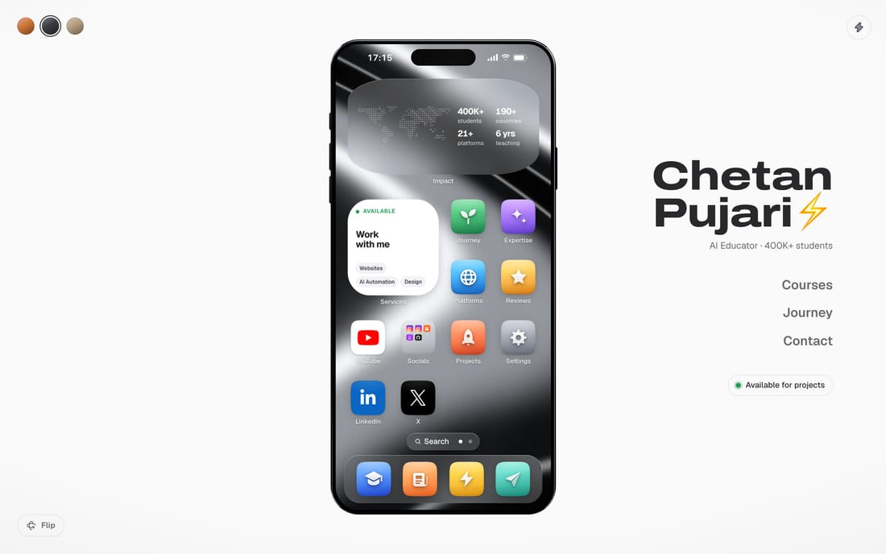
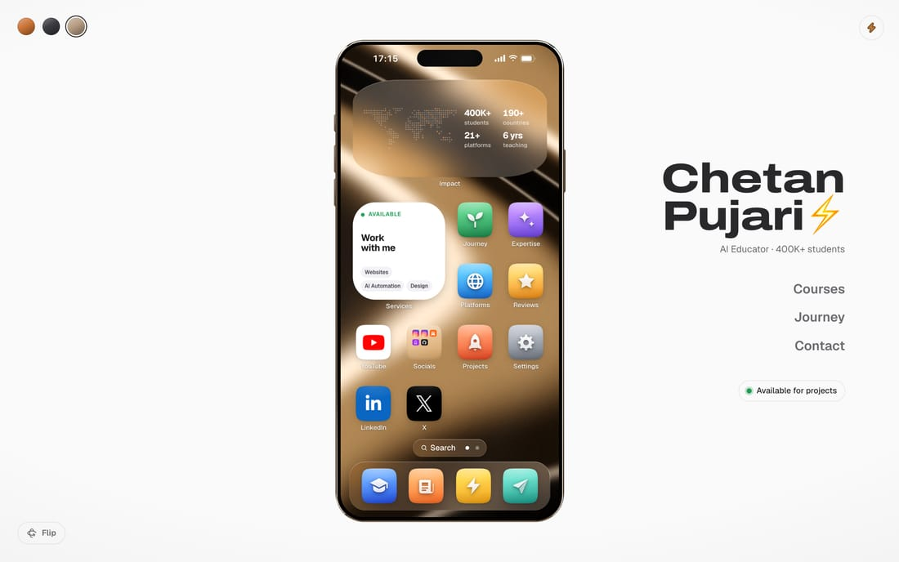
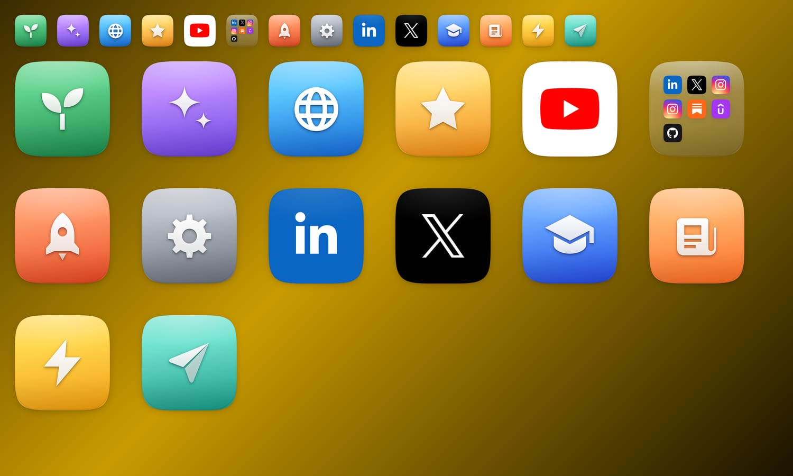
:::

## Originality and brand use, in plain words

- **Your design is yours.** The icons, wallpaper, phone model and code in this template are original. Keep anything you add original too.
- **Study, don't copy.** It's fine to admire another site and describe how it *feels*. Never copy its code, text, images, icons, fonts or 3D models.
- **Brand logos only link to your own profiles.** The LinkedIn, X, YouTube and other marks are there so visitors recognise where a link goes. Use the official mark, in its own colours, undistorted, and only on links to your profiles.
- **Don't use other companies' product designs or logos.** No real phone models, no company logos on the phone, no copies of system app icons.
- **Reviews and numbers must be true.** Only publish real quotes with permission, and real stats.

# Credits, licenses and links

- **Built by Chetan Pujari.** Template code is MIT licensed (see `LICENSE` in the template).
- **The original portfolio:** [github.com/chetanpujari5105/NFCPortfolio](https://github.com/chetanpujari5105/NFCPortfolio)
- **The template:** [github.com/chetanpujari5105/pocket-portfolio-template](https://github.com/chetanpujari5105/pocket-portfolio-template)
- **Inspiration:** the interaction idea comes from [prsd.dev](https://www.prsd.dev/) by Prasad Ware.
- **Claude Code docs:** [code.claude.com/docs](https://code.claude.com/docs/en/quickstart)

## Tools

- Context7: [github.com/upstash/context7](https://github.com/upstash/context7)
- Playwright: [playwright.dev](https://playwright.dev/) · Playwright MCP: [github.com/microsoft/playwright-mcp](https://github.com/microsoft/playwright-mcp)
- Claude in Chrome: [code.claude.com/docs/en/chrome](https://code.claude.com/docs/en/chrome)
- Emil Kowalski's skills: [github.com/emilkowalski/skills](https://github.com/emilkowalski/skills)
- Impeccable: [github.com/pbakaus/impeccable](https://github.com/pbakaus/impeccable)
- Vercel agent skills: [github.com/vercel-labs/agent-skills](https://github.com/vercel-labs/agent-skills) · skills CLI: [github.com/vercel-labs/skills](https://github.com/vercel-labs/skills)
- REA: [github.com/morluto/rea](https://github.com/morluto/rea) · Agent Reach: [github.com/Panniantong/Agent-Reach](https://github.com/Panniantong/Agent-Reach)
- Next.js: [nextjs.org](https://nextjs.org/) · Vercel: [vercel.com](https://vercel.com/) · Resend: [resend.com](https://resend.com/)

## Assets and licenses

- Brand marks: [Simple Icons](https://simpleicons.org/) (CC0) and [Font Awesome Free](https://fontawesome.com/license/free) (CC BY 4.0, the LinkedIn mark).
- Map data: [Natural Earth](https://www.naturalearthdata.com/) (public domain).
- Fonts in this guide: Archivo, Inter and JetBrains Mono (SIL Open Font License), via Fontsource.

## Share your build

Built your own? I'd love to see it. Tag me on LinkedIn ([linkedin.com/in/chetan-pujari-ai](https://www.linkedin.com/in/chetan-pujari-ai)) or X ([@Chetanpujari51](https://x.com/Chetanpujari51)).

# Quick Reference

::: quickref
**The 7 prompts** (each one is also a file in the template's `prompts/` folder)

1. **Build spec:** save as `pocket-portfolio-spec.md`; describes the whole site.
2. **Master prompt:** toolbox, browser, reference notes, then Phase 1.
3. **Run all phases:** phases 2–8 without stopping; "Needs me" list.
4. **v3:** real 3D phone, springs and gestures, lock screen, switcher, PWA.
5. **v4:** stable phone, flagship look, brand marks, GitHub heatmap.
6. **Fix list:** a numbered list of changes, checked and committed.
7. **v5:** fits every phone, folders and App Library, instant app opens.

Path A uses one prompt: **Personalize my portfolio** (`prompts/02-personalize.md`), then fix lists.

**Key commands**

| Command | What it does |
|---|---|
| `claude` | Start Claude Code in this folder |
| Shift+Tab | Switch permission mode (`accept edits on`) |
| `continue` | Resume after an error or a usage limit |
| `npm ci` | Install the project's packages |
| `npm run dev` | Run locally at localhost:3000 |
| `npm run build` | Production build |
| `npm run lint && npm run typecheck` | Code checks |
| `npm run content:check` | Check `/content` against the schemas |
| `npx playwright install chromium` | Install the test browser (once) |
| `npm test` | All tests (`PORT=3200 npm test` if 3100 is busy) |
| `npx playwright test --update-snapshots` | Accept new screenshots after content changes |
| `git push origin main` | Publish; Vercel redeploys |

**Environment variables (all optional)**

`RESEND_API_KEY` · `CONTACT_TO_EMAIL` · `CONTACT_FROM_EMAIL` · `NEXT_PUBLIC_ENABLE_ASK` · `OPENAI_API_KEY` · `OPENAI_MODEL` · `GITHUB_TOKEN` · `NEXT_PUBLIC_SITE_URL`
:::
